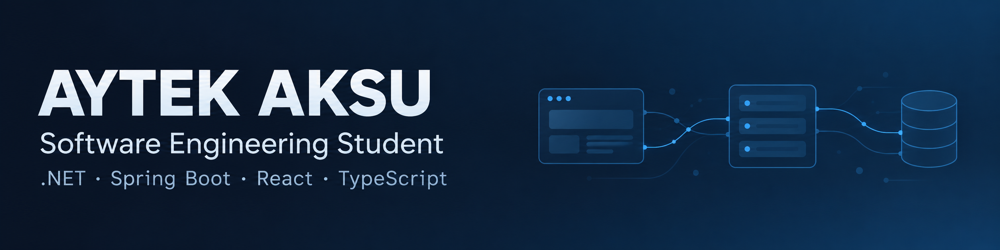

  

<h1 align="center">Hi, I'm Aytek 👋</h1>

  <strong>Software Engineering Student · Backend & Full-Stack Development</strong>

  
  

 

I develop backend applications with **C#/.NET** and **Java/Spring Boot**, and web interfaces with **React and TypeScript**. My projects range from maintenance and inventory management to asynchronous source code analysis.

I'm particularly interested in how **business logic, data, and access control** fit together in an application.

## Featured Projects

<table>
  <tr>
    <td colspan="2" valign="top">
      <h3>🛡️ <a href="https://github.com/Aytekseng/CodeMind-AI">CodeMind-AI</a></h3>
      
<strong>AI-assisted source code security review.</strong>

      
A platform for uploading source files, tracking asynchronous analysis in real time, and exporting findings as PDF reports. A .NET API, Next.js interface, and Python worker communicate through Kafka and MinIO.

      
I managed the development workflow and worked extensively on refining the application.

      
<code>.NET</code> <code>Next.js</code> <code>TypeScript</code> <code>Python</code> <code>PostgreSQL</code> <code>Kafka</code> <code>MinIO</code>

      
<a href="https://github.com/Aytekseng/CodeMind-AI">Explore CodeMind-AI →</a>

    </td>
  </tr>
  <tr>
    <td width="50%" valign="top">
      <h3>🔧 <a href="https://github.com/Aytekseng/Tracing-System">Tracing System</a></h3>
      
<strong>Vehicle maintenance &amp; inventory management.</strong>

      
Connects maintenance records, spare parts, suppliers, and role-based access, including stock deductions and returns.

      
I developed the backend and defined the interface's design and usability requirements.

      
<code>Java</code> <code>Spring Boot</code> <code>React</code> <code>TypeScript</code> <code>PostgreSQL</code> <code>Keycloak</code> <code>Docker</code>

      
<a href="https://github.com/Aytekseng/Tracing-System">Explore Tracing System →</a>

    </td>
    <td width="50%" valign="top">
      <h3>🛒 <a href="https://github.com/Aytekseng/AlicisinaWebProject">Alıcısına</a></h3>
      
<strong>A second-hand vehicle marketplace.</strong>

      
A team project where users can create, browse, and manage vehicle listings through an ASP.NET Core MVC application.

      
I was responsible for most of the backend development within the team.

      
<code>C#</code> <code>ASP.NET Core MVC</code> <code>EF Core</code> <code>Identity</code> <code>Bootstrap</code>

      
<a href="https://github.com/Aytekseng/AlicisinaWebProject">Explore Alıcısına →</a>

    </td>
  </tr>
</table>

## Technologies I Work With

  

**Also used in my projects:** Entity Framework Core · Spring Data JPA · ASP.NET Core Identity · Spring Security · Keycloak · Python · Kafka · MinIO

<strong>More Projects &amp; Experience</strong>

 

| Project | Focus |
| :--- | :--- |
| [MES Factory Simulator](https://github.com/Aytekseng/MES-System-Simulator) | An internship project focused on simulator behavior, machine states, intermediate inventory, and production indicators. |
| [Event Management System](https://github.com/Aytekseng/event-management-system) | Exploring Clean Architecture, CQRS, and MediatR with a React interface. |
| [Computer Lab Reservation System](https://github.com/Aytekseng/dimproject3) | Practicing Spring Boot, reservation workflows, data relationships, and user roles. |

